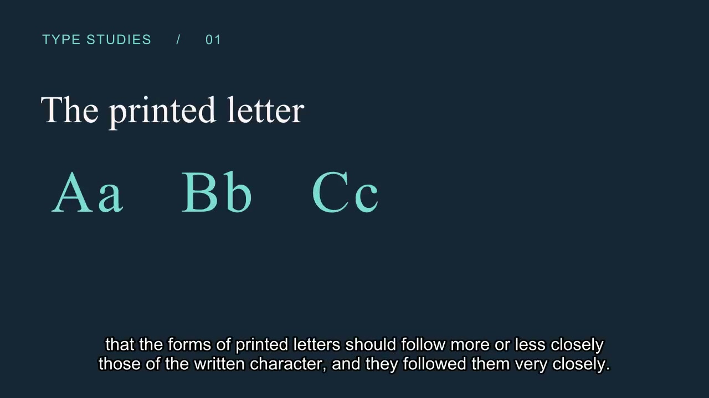

# make-video

A portable [Agent Skill](https://agentskills.io) for creating, resuming, and revising narrated videos in ordinary chat. **The whole skill is [one Markdown file](.github/skills/make-video/SKILL.md).** Your coding agent writes the scenes, prepares narration and captions, and runs the render. You don't need to supply renderer code.

**No Azure subscription, cloud speech account or API key is required.** Try the offline example below before choosing a voice for your own material.

**Start in any file-capable coding agent:** Open a clone or unzipped copy of this repository as your workspace. Paste this into **agent chat**, not a terminal:

> Read `.github/skills/make-video/SKILL.md` and follow it. Interview me for a new video.

The first question is what to base the video on. No skill installation or slash command is needed. To use it in another project or from a skill picker, see [Install or update the skill](#install-or-update-the-skill).

## See an interview and its finished video

**“Show library visitors how handwriting shaped early printed letters.”** Follow the [sample interview](examples/printing/interview.md) from that idea to the finished cut: the same three letter pairs change from slanted handwriting to upright type as a human narrator reads an 1893 passage.

[](examples/printing/sample/video.mp4?raw=true)

**[Watch or download the video (15 seconds, MP4)](examples/printing/sample/video.mp4?raw=true)** · [Read the interview](examples/printing/interview.md) · [Open the editable handoff](examples/printing/sample/HANDOFF.md) · [Get the SRT](examples/printing/sample/captions.srt) · [View the thumbnail](examples/printing/sample/thumbnail.jpg).
No install or render is needed to watch. If your browser downloads the file instead of playing it, open it in your usual video player.

## Try a 15-second video without an account

Download or clone this repository, then open a terminal in its root. With [FFmpeg and ffprobe](#set-up-and-check-ffmpeg) and **Node.js 22+** installed, run:

```text
node examples/printing/render.mjs
```

The included human voice explains how handwriting influenced early printing. The example creates a **15-second clean MP4 and a captioned MP4**, plus `captions.srt` and `thumbnail.jpg` beside each, and a shared editable `HANDOFF.md`. The command prints their paths under a new `out/printing/` run. No agent login, network calls, packages, model downloads or credentials are used by the demo.

Try `node examples/printing/render.mjs ar` for **English narration with Arabic captions**. Default captions are English. Both demonstration tracks use measured phrase boundaries, not word highlights. [Recording credits, transcripts and reuse terms](examples/printing/NOTICE.md). Node is only for this optional demo and smoke test, **not** a skill requirement.

## Install or update the skill

**To add the skill to another workspace**, copy the [make-video folder](.github/skills/make-video), including `SKILL.md`, into **one** project skills directory listed below. For example, a Codex project should contain `.agents/skills/make-video/SKILL.md`. Reload the skills list or start a new chat in that workspace. To update a copied installation, replace that file with the new version. No package manager is required.

| Agent | Project skills directory | Start an interview in chat |
| --- | --- | --- |
| [GitHub Copilot CLI](https://docs.github.com/en/copilot/concepts/agents/about-agent-skills) | `.github/skills/` (already in this checkout) | `/make-video interview` |
| [Claude Code](https://code.claude.com/docs/en/skills) | `.claude/skills/` | `/make-video interview` |
| [OpenAI Codex](https://developers.openai.com/codex/skills/) | `.agents/skills/` | `$make-video interview` |
| [Cursor](https://cursor.com/docs/skills) | `.agents/skills/` | Select `make-video` in the `/` menu, then type `interview`. |
| [Gemini CLI](https://geminicli.com/docs/cli/skills/) | `.agents/skills/` | `Use the make-video skill to interview me.` |
| [OpenCode](https://opencode.ai/docs/skills/) | `.agents/skills/` | `Use the make-video skill to interview me.` |
| [Cline](https://docs.cline.bot/customization/skills) | `.cline/skills/` | Select `/make-video`, then type `interview`. |
| [Windsurf / Devin Local](https://docs.windsurf.com/windsurf/cascade/skills) | `.windsurf/skills/` | `Use the make-video skill to interview me.` |

Prefer an installer? With Node.js 22.20+ and npm, run the optional [Skills CLI](https://github.com/vercel-labs/skills) from the **destination workspace**, then select your agent(s):

```text
npx skills add https://github.com/jaydestro/make-video/tree/main/.github/skills/make-video
```

Existing **Copilot CLI** users can keep a registered checkout: `copilot skill add (Resolve-Path '.github\skills').Path` (PowerShell) or `copilot skill add "$PWD/.github/skills"` (macOS/Linux). Run `copilot skill list` to check discovery and `/skills reload` after a pull. Don't enable two copies of the same skill in one host.

Native discovery was checked in **Copilot CLI and Claude Code on Windows**. The other entries are based on their host documentation; the standalone render is not an end-to-end test of every client. For another agent, an older client, or a missing picker entry, use the direct-file prompt above. Rendering needs a writable workspace and permission to run commands there; a chat-only session can prepare a brief, not an MP4.

## Use it

Once the skill is loaded, use ordinary language in any agent. In a checkout without native discovery, prefix any example with `Read .github/skills/make-video/SKILL.md and follow it.`

| Type this | What happens |
| --- | --- |
| `Use make-video. Interview me for a new video.` | Answer one question at a time, starting with a web URL, document, script, pasted text or topic. The agent recommends the technical settings. |
| `Use make-video: yolo https://science.nasa.gov/eclipses/` | Answer one format check, then let the agent write, narrate, render and verify. A source URL alone after the skill name means the same thing. |
| `Resume my printing video from its saved brief. Change only the closing card.` | Reuse the saved material, preserve the previous delivery, and create a new revision. |
| `I updated the handoff.` | Read the saved edits and revise the current video. No need to paste the changes into chat. |

### Change a finished video

Open the **`HANDOFF.md` linked with your video**. Under **Changes for the next cut**, write something like *“Hold the closing credit one second longer; keep the recording and captions.”* Or edit the settings, narration or scene descriptions directly. Save it, then say **“I updated the handoff.”** In a host with native skill shortcuts, `/make-video update` (or `$make-video update` in Codex) means the same thing.

The agent compares your edits to the delivered cut, keeps everything else, and creates a **new version** with its own MP4, SRT, thumbnail and updated handoff. If nothing changed, it won't render again. In another agent or a fresh chat, open the delivery folder or attach the edited handoff and make the original project sources accessible. The Markdown describes the cut; it doesn't contain the audio and visual assets. [See the handoff for the 15-second example.](examples/printing/sample/HANDOFF.md)

### Choosing a narrator in the interview

Describe the voice you want, for example **“warm and conversational, like someone showing a friend around.”** When the agent offers samples, say **yes** to hear available voices read the same line, or **“you choose”** to skip the comparison. After listening, reply **“2”** or **“the warmer one.”** The agent saves your pick and continues without a second confirmation. If you supplied a recording and asked to use it, it keeps that narrator.

### What YOLO asks

| Setting | Choose |
| --- | --- |
| Screen shape | **Landscape** (wide, default) or **portrait** (vertical). |
| Captions in the picture | **On** (always visible, default), **off** (subtitle file only), or **both** (a captioned MP4 and a clean MP4). |
| Length and audience | Optional. Default: 90-120 seconds including the ending hold, for the audience implied by the page. |
| Languages | What should viewers hear and read? Narration and captions default to the source language, not your device locale. You can request translated phrase captions, e.g. English audio with Arabic subtitles. |
| Call to action | Optional. What should viewers do next? Give an action (e.g. "Try the query"), a destination URL, both, or "none". Your CTA appears on the closing card. |

One reply is enough: **“Portrait, both, about 45 seconds, for beginners. CTA: try the query in your own container.”** After that, the agent takes over. **Every MP4 gets its own SRT subtitle file and JPEG thumbnail**, including previews and videos with captions turned off. Choosing *both* produces two complete sets of three files using the same narration and layout.

To skip even the setup, specify shape, captions and CTA in the request (e.g. `portrait, captions off, CTA: none`), or say `Use make-video: yolo <URL> use defaults`. Label a separate CTA link with `CTA:` so it stays distinct from the source URL.

## What you need on the computer that renders the video

You can **start an interview with just the skill and an agent chat**. To finish a narrated MP4 with FFmpeg, the machine where the agent executes commands needs the following. For cloud or remote agents, check their workspace, not your laptop.

| Needed for rendering | What to have ready |
| --- | --- |
| Encode, mix and inspect media | `ffmpeg` **and** `ffprobe` on `PATH`. Use an FFmpeg build with the `lavfi` input, `color` and `apad` filters, `ass` filter (libass for text/diagrams), `libx264` and `aac` encoders for MP4, and `mjpeg` for the thumbnail. Even a clean video can use libass to draw its scene labels. |
| Draw readable text | An installed font covering the language of the video, e.g. Segoe UI on Windows or DejaVu Sans for Latin text on Linux. No browser or GPU is required for this render path. |
| Narrate and synchronize | **One** usable speech route: an installed neural speech engine **and its licensed voice model**; a configured, explicitly authorized speech service; or a permitted recording of the exact script. For synchronized captions, use provider timings, supplied timings, or an available local alignment tool. Word highlights need word-level timing. FFmpeg encodes audio; it does **not** create a natural voice. |
| Read and write the job | Read access to the source URL or local material and a writable private project folder with room for audio, previews and one MP4 per variant. An online source or hosted voice needs network access; local files plus a local voice can render offline. |

No separate renderer checkout, Python scripts, Node installation, or API key is required by the **skill itself**. A *chosen speech engine* can have its own installation or credential requirements. Keep credentials outside the brief and chat.

### Set up and check FFmpeg

If either command below is missing, install an FFmpeg distribution that includes both programs, then open a **new terminal** so it sees the updated `PATH`. Typical package-manager commands (choose only the one for your machine):

| Windows with WinGet | macOS with Homebrew | Ubuntu/Debian |
| --- | --- | --- |
| `winget install --id Gyan.FFmpeg -e` | `brew install ffmpeg-full` | `sudo apt install ffmpeg fonts-dejavu-core` |

On macOS, the full formula supplies libass and is keg-only. Before running the checks or demo, run `export PATH="$(brew --prefix ffmpeg-full)/bin:$PATH"` in that terminal. Use a font with the necessary glyphs and shaping support (e.g. DejaVu Sans or a suitable Noto font for the language).

Run these checks in the agent's render environment:

```text
ffmpeg -version
ffprobe -version
ffmpeg -hide_banner -h filter=ass
```

Both tools should print versions, and the last command should describe the **ass** filter. If it reports an unknown filter, use a build with **libass** enabled.

**Optional one-second encode test:** Run these in an empty, writable folder. They create a blue picture and a test tone, not a narrated video:

```text
ffmpeg -nostdin -v error -n -f lavfi -i color=c=navy:s=320x180:r=30 -f lavfi -i sine=frequency=440:sample_rate=48000 -af apad -t 1 -c:v libx264 -pix_fmt yuv420p -c:a aac make-video-check.mp4
ffprobe -v error -show_entries stream=codec_type,codec_name,width,height -of compact make-video-check.mp4
ffmpeg -nostdin -v error -n -ss 0.5 -i make-video-check.mp4 -frames:v 1 -c:v mjpeg make-video-check.jpg
```

Expect an H.264 video stream at 320x180, an AAC audio stream, and a JPEG. You can delete the two `make-video-check` files afterward. If FFmpeg reports an unknown encoder, choose a build with the named encoder enabled.

### Voice and permissions

The skill prefers models and tools that can generate expressive, natural-sounding speech. It checks phrasing on a sentence from the script; it won't substitute a robotic voice just because one is installed. **For YOLO, set up and authorize your narration route before starting.** A cloud API key alone is not consent to send the script or incur charges.

For **new synthetic narration with no speech account**, follow the [local Piper recipe](examples/local-voice/README.md): install a CPU engine in a private environment, fetch a checksum-pinned English voice once, audition a sentence, then generate a full WAV and phrase-timed SRT offline. Or bring your own permitted recording and timings. Hosted speech services are optional; no specific provider is preferred.

After the format check, YOLO makes no further creative requests. It does not install software, bypass host permissions or approve new spending for you. If an essential prerequisite is missing, it saves the draft and reports exactly what is missing instead of delivering a silent or incorrectly narrated MP4.

## License and contributing

The skill, docs, example code and original designs use the [MIT license](LICENSE). The [public-domain recording](examples/printing/NOTICE.md) and [external engine/model](examples/local-voice/README.md) have separately documented terms. A source URL is a reference, not permission to republish photos, music, or a person's voice. Keep private briefs, credentials and generated projects out of commits.

See [CONTRIBUTING.md](CONTRIBUTING.md) for the offline release check, platform coverage, safe bug reports and release checklist.
